# 校园周边美食探索及分享平台的设计与实现

> 🎓 **计算机毕业设计 · 校园周边美食探索及分享平台的设计与实现**
>
> 本仓库只放**项目介绍 + 运行截图**（截图是站点带水印的原图，存在仓库 `images/` 里）。
>
> 👉 **完整可运行源码 / 数据库脚本 / 部署文档：[点我获取](https://geekcode.top/archives/%E6%A0%A1%E5%9B%AD%E5%91%A8%E8%BE%B9%E7%BE%8E%E9%A3%9F%E6%8E%A2%E7%B4%A2%E5%8F%8A%E5%88%86%E4%BA%AB%E5%B9%B3%E5%8F%B0%E7%9A%84%E8%AE%BE%E8%AE%A1%E4%B8%8E%E5%AE%9E%E7%8E%B0?utm_source=github)**
>
> 💬 咨询微信：**ir9372**　|　🌐 更多项目：[极客代码 geekcode.top](https://geekcode.top/?utm_source=github)
>
> 📌 项目详情页：<https://geekcode.top/archives/%E6%A0%A1%E5%9B%AD%E5%91%A8%E8%BE%B9%E7%BE%8E%E9%A3%9F%E6%8E%A2%E7%B4%A2%E5%8F%8A%E5%88%86%E4%BA%AB%E5%B9%B3%E5%8F%B0%E7%9A%84%E8%AE%BE%E8%AE%A1%E4%B8%8E%E5%AE%9E%E7%8E%B0?utm_source=github>

<table><td width="230" align="center"> <b>扫码加微信 ir9372</b></td><td valign="middle">📦 源码 = 项目介绍 + 全部运行截图 + 数据库 + 部署文档 👉 点上方任意截图，直接跳到 <b>极客代码 geekcode.top</b> 详情页</td></table>

---

<h1>校园周边美食探索及分享平台的设计与实现</h1>
<h2>项目概述</h2>

本项目面向校园周边美食内容的探索、分享与收藏场景，设计并实现一个前后端一体化的美食分享平台。系统包含前台用户端和后台管理端：前台用户可注册登录，浏览首页与美食鉴赏列表、查看详情，查看美食鉴赏评论列表与详情，进入个人中心管理我的收藏和我的好友，并可查看注册用户列表；后台管理员可登录后台首页，对美食鉴赏、用户、美食鉴赏评论、我的收藏、轮播图和我的好友进行管理。项目采用 Spring Boot 构建后端服务，Vue 集成前端页面，MyBatis-Plus 负责数据访问，Shiro 提供登录认证与访问控制，MySQL 存储业务数据。平台适用于校园周边用户进行美食信息浏览、内容分享、收藏管理与好友关系维护。

<h2>技术架构</h2>
<h3>总体架构</h3>

本项目为 <code>vue-integrated</code> 类型工程，前端页面与后端 Spring Boot 服务集成部署。前端通过 Vue 页面承载前台用户端与后台管理端界面，后端通过 Spring Boot Web 提供接口服务，并基于 MyBatis-Plus 访问 MySQL 数据库。项目引入 Shiro 作为安全框架，用于登录认证与访问控制；引入 MyBatis-Plus、MyBatis Spring Boot Starter、Spring Boot JDBC、MySQL Connector 等组件完成持久层与数据库连接；引入 <code>commons-lang3</code>、<code>validation-api</code> 等基础依赖用于通用处理与参数校验。

<a href="https://geekcode.top/archives/%E6%A0%A1%E5%9B%AD%E5%91%A8%E8%BE%B9%E7%BE%8E%E9%A3%9F%E6%8E%A2%E7%B4%A2%E5%8F%8A%E5%88%86%E4%BA%AB%E5%B9%B3%E5%8F%B0%E7%9A%84%E8%AE%BE%E8%AE%A1%E4%B8%8E%E5%AE%9E%E7%8E%B0?utm_source=github" title="查看完整源码">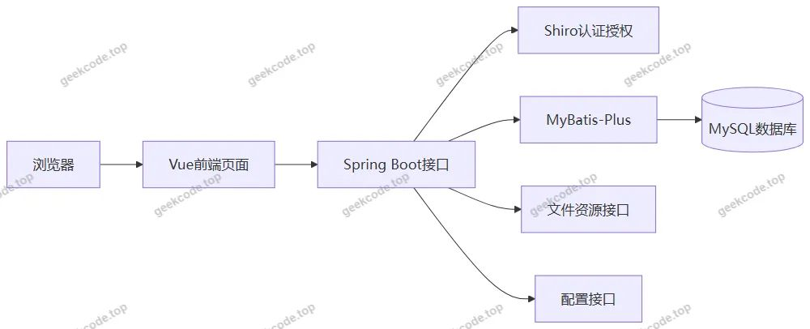</a>

<h3>后端架构</h3>

后端采用 Spring Boot 分层架构。Controller 层负责接收前端请求并返回响应结果，项目中的控制器包括：

<ul>
<li><code>CommonController</code>：提供公共接口支撑。</li>
<li><code>ConfigController</code>：提供配置相关接口支撑。</li>
<li><code>DefaultuserController</code>：提供默认用户相关接口支撑。</li>
<li><code>DiscussmeishijianshangController</code>：提供美食鉴赏评论相关接口支撑。</li>
<li><code>FileController</code>：提供文件资源相关接口支撑。</li>
<li><code>MeishijianshangController</code>：提供美食鉴赏相关接口支撑。</li>
<li><code>StoreupController</code>：提供收藏相关接口支撑。</li>
<li><code>UserController</code>：提供用户相关接口支撑。</li>
<li><code>WodehaoyouController</code>：提供我的好友相关接口支撑。</li>
<li><code>YonghuController</code>：提供用户信息相关接口支撑。</li>
</ul>

数据访问层采用 MyBatis-Plus，在 MyBatis 基础上增强通用 CRUD 能力，适合本项目中美食鉴赏、用户、评论、收藏、好友、配置等实体的持久化操作。

<h3>前端架构</h3>

前端为 Vue 集成页面，包含前台用户端页面和后台管理端页面。根据截图与菜单信息，前台页面覆盖首页、登录、注册、美食鉴赏列表、美食鉴赏详情、美食鉴赏评论列表、美食鉴赏评论详情、个人中心、我的收藏、我的好友、注册用户列表等；后台页面覆盖登录、首页、美食鉴赏、用户、美食鉴赏评论、我的收藏、轮播图、我的好友等管理界面。

<h3>数据库设计要点</h3>

数据库设计围绕平台核心业务对象展开，主要包括：

<ul>
<li>用户数据：支撑前台注册、登录、用户列表、个人中心、后台用户管理等功能。</li>
<li>美食鉴赏数据：支撑美食鉴赏列表、详情、后台美食鉴赏管理等功能。</li>
<li>美食鉴赏评论数据：支撑评论列表、评论详情、后台评论管理等功能。</li>
<li>收藏数据：支撑前台我的收藏列表、后台我的收藏管理等功能。</li>
<li>好友数据：支撑前台我的好友列表、后台我的好友管理等功能。</li>
<li>配置数据：支撑轮播图、系统展示内容等配置管理。</li>
<li>文件资源数据：支撑图片、轮播图等资源相关接口访问。</li>
</ul>

各业务对象之间通过用户标识、美食鉴赏标识、评论标识等建立关联，形成“用户—美食鉴赏—评论—收藏—好友—配置”的数据组织方式。

<h3>核心技术选型理由</h3>
<ul>
<li><strong>Spring Boot</strong>：用于快速构建 Web 后端服务，简化配置与部署。</li>
<li><strong>Vue 集成</strong>：用于构建前台与后台页面，实现前后端一体化展示。</li>
<li><strong>MyBatis-Plus</strong>：用于增强持久层开发效率，适合常规业务表的数据访问。</li>
<li><strong>Shiro</strong>：用于登录认证与访问控制，保障前台用户端与后台管理端的访问边界。</li>
<li><strong>MySQL</strong>：用于存储用户、美食鉴赏、评论、收藏、好友、配置等结构化业务数据。</li>
<li><strong>commons-lang3、validation-api</strong>：用于通用工具处理与参数校验，提升接口稳定性。</li>
</ul>
<h2>功能模块</h2>
<h3>前台用户端功能模块</h3>
<table>
<thead>
<tr>
<th>模块</th>
<th>功能描述</th>
</tr>
</thead>
<tbody><tr>
<td>前台首页</td>
<td>展示平台首页内容，作为用户进入美食鉴赏、好友、个人中心等功能的入口。</td>
</tr>
<tr>
<td>用户注册</td>
<td>提供注册用户入口，用于创建前台用户账号。</td>
</tr>
<tr>
<td>用户登录</td>
<td>提供前台用户登录入口，登录后进入个人相关业务页面。</td>
</tr>
<tr>
<td>美食鉴赏列表</td>
<td>展示美食鉴赏内容列表，用户可浏览平台提供的美食鉴赏信息。</td>
</tr>
<tr>
<td>美食鉴赏详情</td>
<td>展示单条美食鉴赏内容的详细信息。</td>
</tr>
<tr>
<td>美食鉴赏评论列表</td>
<td>展示美食鉴赏相关评论内容列表。</td>
</tr>
<tr>
<td>美食鉴赏评论详情</td>
<td>展示单条评论的详细内容。</td>
</tr>
<tr>
<td>个人中心</td>
<td>展示当前登录用户的个人相关信息与入口。</td>
</tr>
<tr>
<td>我的收藏</td>
<td>展示当前用户的收藏内容列表。</td>
</tr>
<tr>
<td>我的好友</td>
<td>展示当前用户的好友关系列表。</td>
</tr>
<tr>
<td>注册用户列表</td>
<td>展示注册用户相关信息列表。</td>
</tr>
</tbody></table>

前台导航菜单包括：<strong>美食鉴赏、我的好友</strong>。 个人中心菜单包括：<strong>个人中心、我的收藏</strong>。

<h3>后台管理端功能模块</h3>

后台路由包括：<code>/meishijianshang</code>、<code>/yonghu</code>、<code>/discussmeishijianshang</code>、<code>/storeup</code>、<code>/config</code>、<code>/wodehaoyou</code>。

<table>
<thead>
<tr>
<th>模块</th>
<th>功能描述</th>
</tr>
</thead>
<tbody><tr>
<td>后台登录页</td>
<td>管理员进入后台管理系统的登录入口。</td>
</tr>
<tr>
<td>后台首页</td>
<td>展示后台管理端首页，作为后台功能入口。</td>
</tr>
<tr>
<td>美食鉴赏管理</td>
<td>对美食鉴赏业务数据进行后台管理。</td>
</tr>
<tr>
<td>用户管理</td>
<td>对平台用户数据进行后台管理。</td>
</tr>
<tr>
<td>美食鉴赏评论管理</td>
<td>对美食鉴赏评论内容进行后台管理。</td>
</tr>
<tr>
<td>我的收藏管理</td>
<td>对用户收藏数据进行后台管理。</td>
</tr>
<tr>
<td>轮播图管理</td>
<td>对轮播图展示内容进行后台管理。</td>
</tr>
<tr>
<td>我的好友管理</td>
<td>对好友关系数据进行后台管理。</td>
</tr>
</tbody></table>
<h2>用户角色与权限</h2>

根据项目页面与功能结构，系统主要包含两类角色：<strong>普通注册用户</strong>和<strong>系统管理员</strong>。

<table>
<thead>
<tr>
<th>角色</th>
<th>可访问范围</th>
<th>主要权限</th>
</tr>
</thead>
<tbody><tr>
<td>普通注册用户</td>
<td>前台用户端</td>
<td>注册账号、登录系统；浏览前台首页；查看美食鉴赏列表与详情；查看美食鉴赏评论列表与评论详情；进入个人中心；查看我的收藏列表；查看我的好友列表；查看注册用户列表。</td>
</tr>
<tr>
<td>系统管理员</td>
<td>后台管理端</td>
<td>登录后台；访问后台首页；管理美食鉴赏；管理用户；管理美食鉴赏评论；管理我的收藏；管理轮播图；管理我的好友。</td>
</tr>
</tbody></table>
<h3>权限说明</h3>

项目技术栈包含 Shiro，用于登录认证与访问控制。前台用户端页面主要面向注册用户，个人收藏、好友、个人中心等数据与当前登录用户关联；后台管理端页面主要面向管理员，用于维护美食鉴赏、用户、评论、收藏、轮播图、好友等系统数据。

<h2>项目特色与创新点</h2>
<h3>1. 聚焦校园周边美食分享场景</h3>

项目围绕“校园周边美食探索及分享”这一具体场景展开，将美食鉴赏内容作为核心业务对象，满足校园周边用户对美食信息浏览、内容查看和收藏管理的需求。

<h3>2. 前台与后台一体化设计</h3>

项目采用 <code>vue-integrated</code> 集成方式，前端页面与 Spring Boot 后端服务统一组织，前台用户端和后台管理端均纳入同一项目结构中，便于开发、部署与演示。

<h3>3. 业务模块覆盖较完整</h3>

系统不仅包含美食鉴赏内容展示，还覆盖评论查看、个人中心、我的收藏、我的好友、注册用户列表等前台功能，同时提供后台对美食鉴赏、用户、评论、收藏、轮播图、好友等模块的管理能力，形成较完整的平台使用路径。

<h3>4. 基于 Shiro 的访问控制</h3>

项目引入 Shiro 作为安全框架，用于保障用户登录、后台访问以及不同角色之间的访问边界，使前台用户与后台管理员能够按各自角色使用系统功能。

<h3>5. 基于 MyBatis-Plus 的数据访问增强</h3>

项目采用 MyBatis-Plus 进行持久层开发，适用于用户、美食鉴赏、评论、收藏、好友、配置等常规业务表的数据访问，提高开发效率并降低重复 SQL 编写成本。

<h3>6. 支持内容展示与运营维护</h3>

系统包含轮播图管理和配置相关接口，可为平台首页展示、图片资源、运营内容等提供维护支撑，使管理员能够对平台展示内容进行统一管理。

<h2>部署环境</h2>
<h3>软件环境要求</h3>
<table>
<thead>
<tr>
<th>环境</th>
<th>说明</th>
</tr>
</thead>
<tbody><tr>
<td>JDK</td>
<td>需要 Java 运行环境，建议 JDK 8 及以上，具体版本以项目实际配置为准。</td>
</tr>
<tr>
<td>MySQL</td>
<td>需要关系型数据库，用于存储用户、美食鉴赏、评论、收藏、好友、配置等数据。常见可使用 MySQL 5.7 或 8.0，具体以项目配置为准。</td>
</tr>
<tr>
<td>Node.js</td>
<td>项目为 Vue 集成类型，前端页面构建与运行通常需要 Node.js 环境。</td>
</tr>
<tr>
<td>npm 或 yarn</td>
<td>用于安装前端依赖和构建前端资源，具体以项目实际包管理方式为准。</td>
</tr>
<tr>
<td>Maven 或 Gradle</td>
<td>用于构建 Spring Boot 后端工程，具体以项目实际构建工具为准。</td>
</tr>
<tr>
<td>浏览器</td>
<td>建议使用 Chrome、Edge 等现代浏览器访问前台用户端与后台管理端页面。</td>
</tr>
<tr>
<td>IDE</td>
<td>可使用 IntelliJ IDEA、Eclipse 等 Java 开发工具进行项目导入、运行与调试。</td>
</tr>
</tbody></table>
<h3>部署运行说明</h3>
<ol>
<li>准备 MySQL 数据库，并按项目配置创建数据库、用户、美食鉴赏、评论、收藏、好友、配置等相关业务表。  </li>
<li>配置后端数据源，包括数据库地址、数据库名、用户名、密码等连接信息。  </li>
<li>准备 JDK 环境，确保 Spring Boot 工程可正常编译运行。  </li>
<li>准备 Node.js 环境，安装前端依赖并构建 Vue 页面资源。  </li>
<li>启动 Spring Boot 应用，访问前台用户端首页与后台管理端登录页。  </li>
<li>前台用户通过注册、登录进入美食鉴赏、个人中心、我的收藏、我的好友等页面；管理员通过后台登录页进入后台管理端，对美食鉴赏、用户、评论、收藏、轮播图、好友等模块进行管理。</li>
</ol>
<h2>五、技术特性</h2>
<ul>
<li>前后端集成部署，前端资源打包至后端 static 目录</li>
<li>使用 MyBatis-Plus 简化数据访问层开发</li>
<li>集成 Shiro 权限框架实现角色权限控制</li>
</ul>
<h2>六、功能模块截图</h2>
<h3>前台用户端</h3>
<h4>前台首页</h4>

<a href="https://geekcode.top/archives/%E6%A0%A1%E5%9B%AD%E5%91%A8%E8%BE%B9%E7%BE%8E%E9%A3%9F%E6%8E%A2%E7%B4%A2%E5%8F%8A%E5%88%86%E4%BA%AB%E5%B9%B3%E5%8F%B0%E7%9A%84%E8%AE%BE%E8%AE%A1%E4%B8%8E%E5%AE%9E%E7%8E%B0?utm_source=github" title="查看完整源码">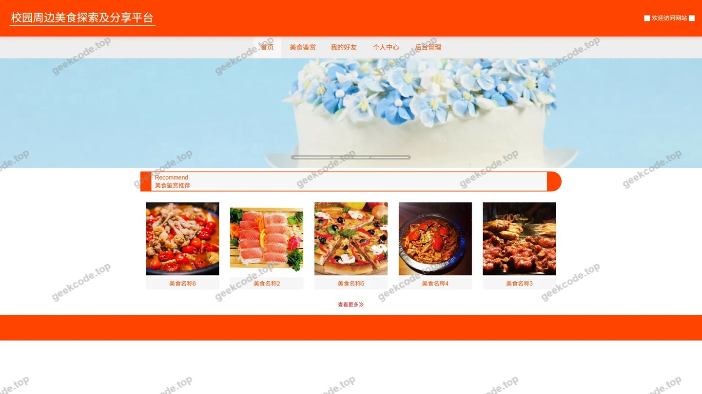</a>

<h4>前台登录页</h4>

<a href="https://geekcode.top/archives/%E6%A0%A1%E5%9B%AD%E5%91%A8%E8%BE%B9%E7%BE%8E%E9%A3%9F%E6%8E%A2%E7%B4%A2%E5%8F%8A%E5%88%86%E4%BA%AB%E5%B9%B3%E5%8F%B0%E7%9A%84%E8%AE%BE%E8%AE%A1%E4%B8%8E%E5%AE%9E%E7%8E%B0?utm_source=github" title="查看完整源码">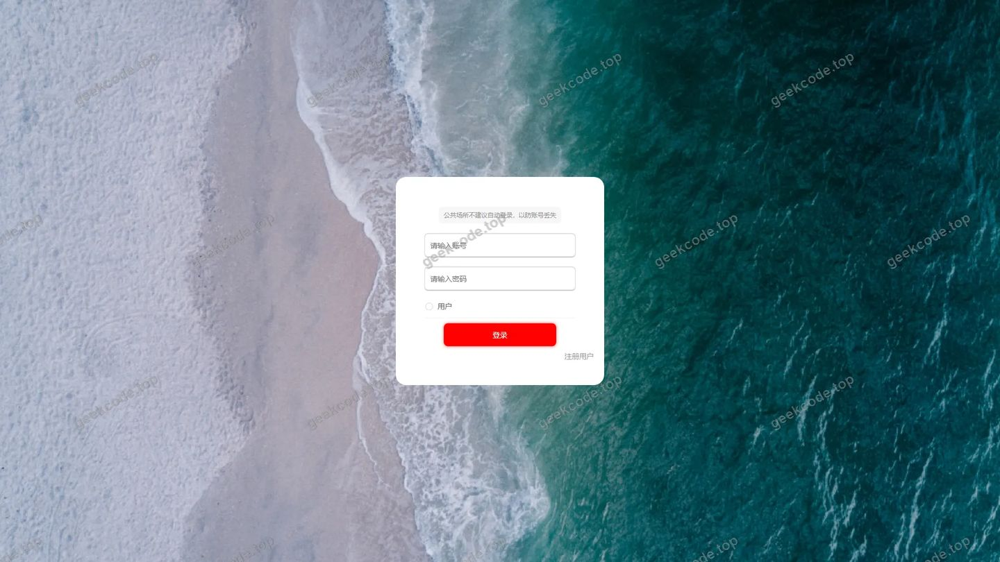</a>

<h4>前台注册页</h4>

<a href="https://geekcode.top/archives/%E6%A0%A1%E5%9B%AD%E5%91%A8%E8%BE%B9%E7%BE%8E%E9%A3%9F%E6%8E%A2%E7%B4%A2%E5%8F%8A%E5%88%86%E4%BA%AB%E5%B9%B3%E5%8F%B0%E7%9A%84%E8%AE%BE%E8%AE%A1%E4%B8%8E%E5%AE%9E%E7%8E%B0?utm_source=github" title="查看完整源码">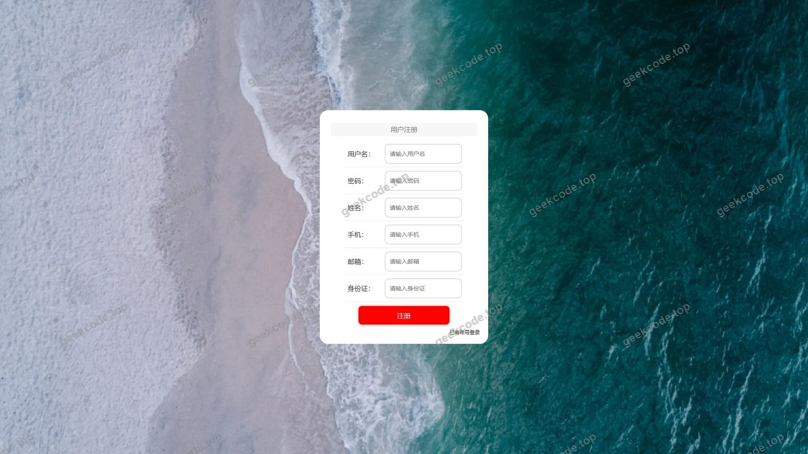</a>

<h4>前台-美食鉴赏列表</h4>

<a href="https://geekcode.top/archives/%E6%A0%A1%E5%9B%AD%E5%91%A8%E8%BE%B9%E7%BE%8E%E9%A3%9F%E6%8E%A2%E7%B4%A2%E5%8F%8A%E5%88%86%E4%BA%AB%E5%B9%B3%E5%8F%B0%E7%9A%84%E8%AE%BE%E8%AE%A1%E4%B8%8E%E5%AE%9E%E7%8E%B0?utm_source=github" title="查看完整源码">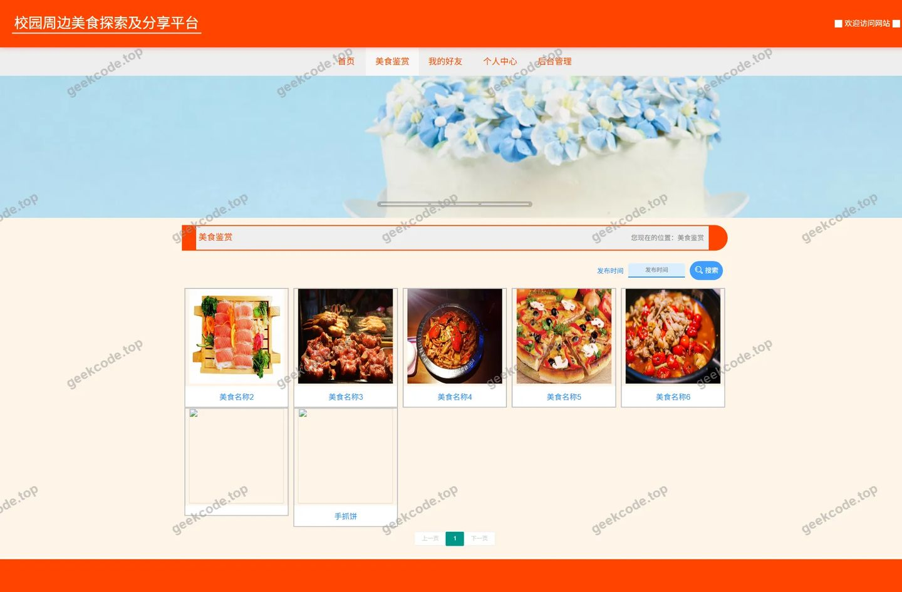</a>

<h4>前台-美食鉴赏评论列表</h4>

<a href="https://geekcode.top/archives/%E6%A0%A1%E5%9B%AD%E5%91%A8%E8%BE%B9%E7%BE%8E%E9%A3%9F%E6%8E%A2%E7%B4%A2%E5%8F%8A%E5%88%86%E4%BA%AB%E5%B9%B3%E5%8F%B0%E7%9A%84%E8%AE%BE%E8%AE%A1%E4%B8%8E%E5%AE%9E%E7%8E%B0?utm_source=github" title="查看完整源码">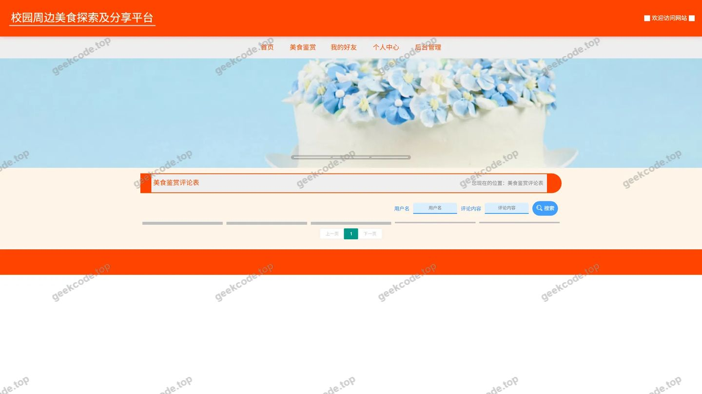</a>

<h4>前台个人中心</h4>

<a href="https://geekcode.top/archives/%E6%A0%A1%E5%9B%AD%E5%91%A8%E8%BE%B9%E7%BE%8E%E9%A3%9F%E6%8E%A2%E7%B4%A2%E5%8F%8A%E5%88%86%E4%BA%AB%E5%B9%B3%E5%8F%B0%E7%9A%84%E8%AE%BE%E8%AE%A1%E4%B8%8E%E5%AE%9E%E7%8E%B0?utm_source=github" title="查看完整源码">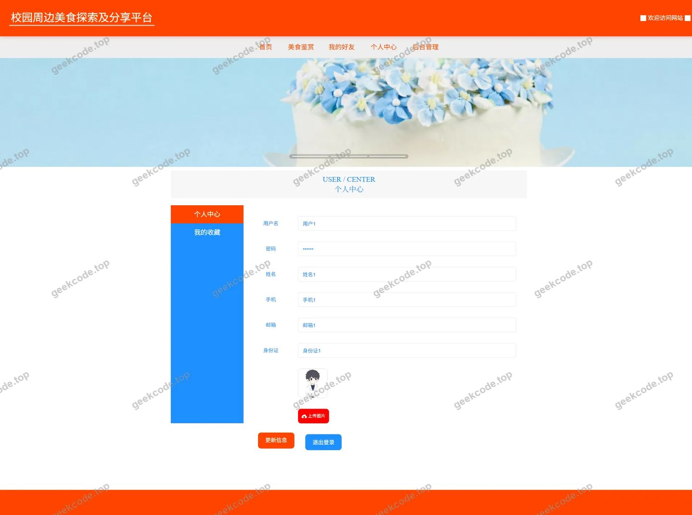</a>

<h4>前台-我的收藏列表</h4>

<h4>前台-我的好友列表</h4>

<a href="https://geekcode.top/archives/%E6%A0%A1%E5%9B%AD%E5%91%A8%E8%BE%B9%E7%BE%8E%E9%A3%9F%E6%8E%A2%E7%B4%A2%E5%8F%8A%E5%88%86%E4%BA%AB%E5%B9%B3%E5%8F%B0%E7%9A%84%E8%AE%BE%E8%AE%A1%E4%B8%8E%E5%AE%9E%E7%8E%B0?utm_source=github" title="查看完整源码">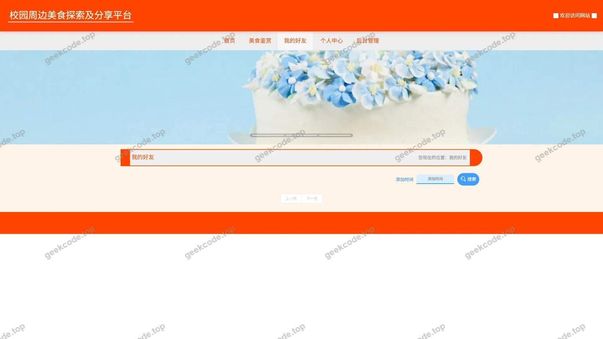</a>

<h4>前台-美食鉴赏-详情</h4>

<a href="https://geekcode.top/archives/%E6%A0%A1%E5%9B%AD%E5%91%A8%E8%BE%B9%E7%BE%8E%E9%A3%9F%E6%8E%A2%E7%B4%A2%E5%8F%8A%E5%88%86%E4%BA%AB%E5%B9%B3%E5%8F%B0%E7%9A%84%E8%AE%BE%E8%AE%A1%E4%B8%8E%E5%AE%9E%E7%8E%B0?utm_source=github" title="查看完整源码">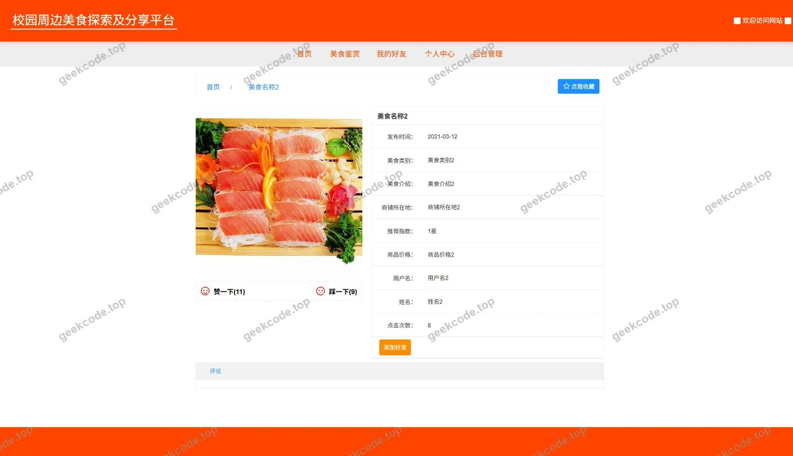</a>

<h4>前台-注册用户列表</h4>

<a href="https://geekcode.top/archives/%E6%A0%A1%E5%9B%AD%E5%91%A8%E8%BE%B9%E7%BE%8E%E9%A3%9F%E6%8E%A2%E7%B4%A2%E5%8F%8A%E5%88%86%E4%BA%AB%E5%B9%B3%E5%8F%B0%E7%9A%84%E8%AE%BE%E8%AE%A1%E4%B8%8E%E5%AE%9E%E7%8E%B0?utm_source=github" title="查看完整源码">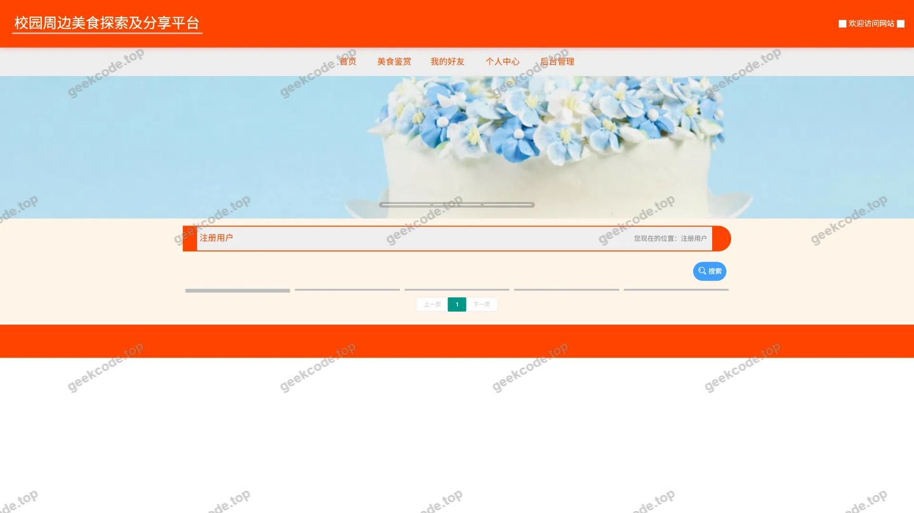</a>

<h4>前台-美食鉴赏评论-详情</h4>

<a href="https://geekcode.top/archives/%E6%A0%A1%E5%9B%AD%E5%91%A8%E8%BE%B9%E7%BE%8E%E9%A3%9F%E6%8E%A2%E7%B4%A2%E5%8F%8A%E5%88%86%E4%BA%AB%E5%B9%B3%E5%8F%B0%E7%9A%84%E8%AE%BE%E8%AE%A1%E4%B8%8E%E5%AE%9E%E7%8E%B0?utm_source=github" title="查看完整源码">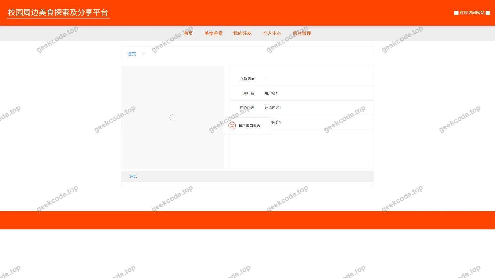</a>

<h3>后台管理端</h3>
<h4>后台-系统配置</h4>

<a href="https://geekcode.top/archives/%E6%A0%A1%E5%9B%AD%E5%91%A8%E8%BE%B9%E7%BE%8E%E9%A3%9F%E6%8E%A2%E7%B4%A2%E5%8F%8A%E5%88%86%E4%BA%AB%E5%B9%B3%E5%8F%B0%E7%9A%84%E8%AE%BE%E8%AE%A1%E4%B8%8E%E5%AE%9E%E7%8E%B0?utm_source=github" title="查看完整源码">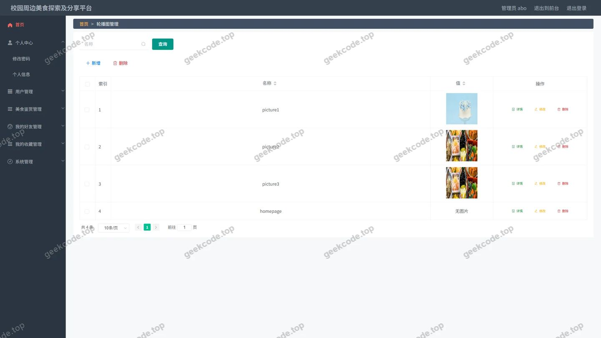</a>

<h4>后台-美食鉴赏评论</h4>

<a href="https://geekcode.top/archives/%E6%A0%A1%E5%9B%AD%E5%91%A8%E8%BE%B9%E7%BE%8E%E9%A3%9F%E6%8E%A2%E7%B4%A2%E5%8F%8A%E5%88%86%E4%BA%AB%E5%B9%B3%E5%8F%B0%E7%9A%84%E8%AE%BE%E8%AE%A1%E4%B8%8E%E5%AE%9E%E7%8E%B0?utm_source=github" title="查看完整源码">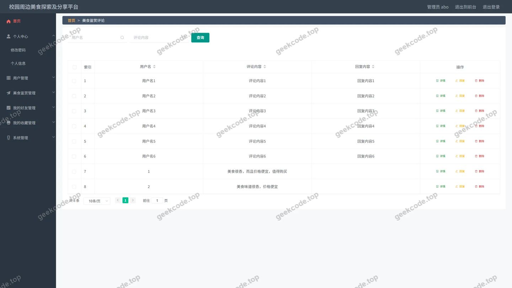</a>

<h4>后台首页</h4>

<a href="https://geekcode.top/archives/%E6%A0%A1%E5%9B%AD%E5%91%A8%E8%BE%B9%E7%BE%8E%E9%A3%9F%E6%8E%A2%E7%B4%A2%E5%8F%8A%E5%88%86%E4%BA%AB%E5%B9%B3%E5%8F%B0%E7%9A%84%E8%AE%BE%E8%AE%A1%E4%B8%8E%E5%AE%9E%E7%8E%B0?utm_source=github" title="查看完整源码">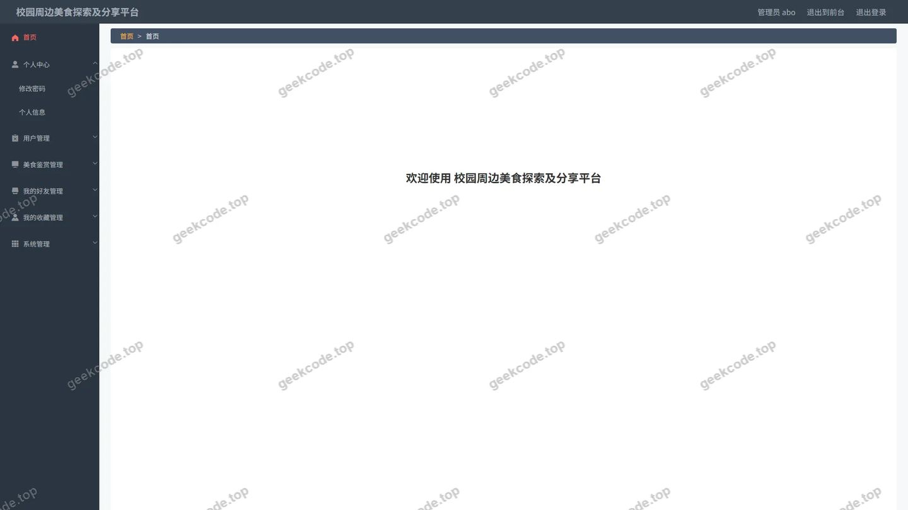</a>

<h4>后台-登录</h4>

<h4>后台-美食鉴赏</h4>

<a href="https://geekcode.top/archives/%E6%A0%A1%E5%9B%AD%E5%91%A8%E8%BE%B9%E7%BE%8E%E9%A3%9F%E6%8E%A2%E7%B4%A2%E5%8F%8A%E5%88%86%E4%BA%AB%E5%B9%B3%E5%8F%B0%E7%9A%84%E8%AE%BE%E8%AE%A1%E4%B8%8E%E5%AE%9E%E7%8E%B0?utm_source=github" title="查看完整源码">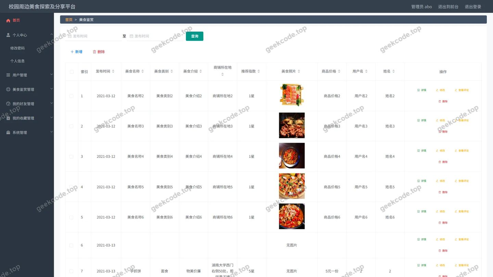</a>

<h4>后台-收藏</h4>

<a href="https://geekcode.top/archives/%E6%A0%A1%E5%9B%AD%E5%91%A8%E8%BE%B9%E7%BE%8E%E9%A3%9F%E6%8E%A2%E7%B4%A2%E5%8F%8A%E5%88%86%E4%BA%AB%E5%B9%B3%E5%8F%B0%E7%9A%84%E8%AE%BE%E8%AE%A1%E4%B8%8E%E5%AE%9E%E7%8E%B0?utm_source=github" title="查看完整源码">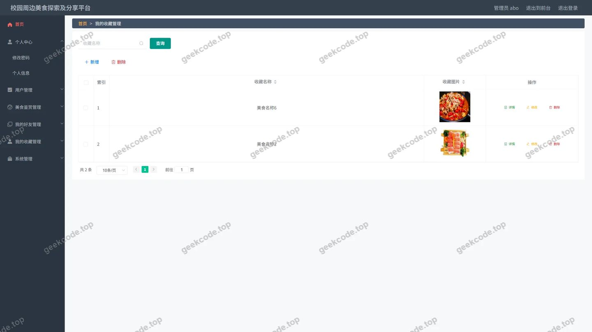</a>

<h4>后台-我的好友</h4>

<a href="https://geekcode.top/archives/%E6%A0%A1%E5%9B%AD%E5%91%A8%E8%BE%B9%E7%BE%8E%E9%A3%9F%E6%8E%A2%E7%B4%A2%E5%8F%8A%E5%88%86%E4%BA%AB%E5%B9%B3%E5%8F%B0%E7%9A%84%E8%AE%BE%E8%AE%A1%E4%B8%8E%E5%AE%9E%E7%8E%B0?utm_source=github" title="查看完整源码">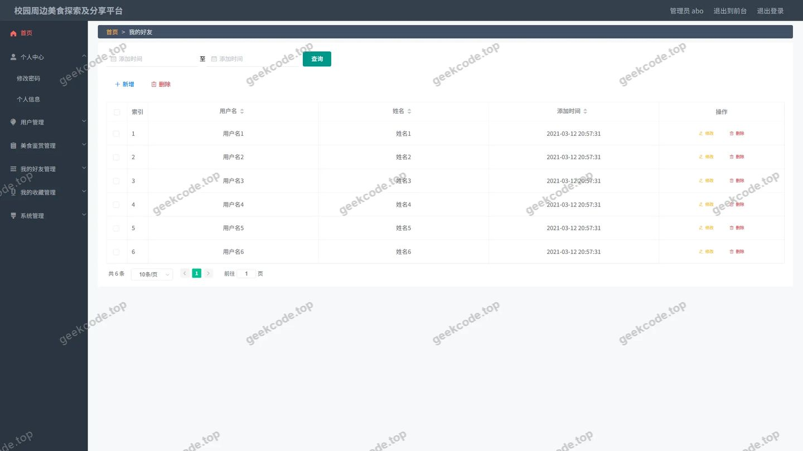</a>

---

## 获取完整源码

| 项目 | 说明 |
| --- | --- |
| 项目名 | 校园周边美食探索及分享平台的设计与实现 |
| 运行截图 | 本文 19 张（站点带水印原图，仓库 `images/` 目录） |
| 完整源码 | [https://geekcode.top/archives/%E6%A0%A1%E5%9B%AD%E5%91%A8%E8%BE%B9%E7%BE%8E%E9%A3%9F%E6%8E%A2%E7%B4%A2%E5%8F%8A%E5%88%86%E4%BA%AB%E5%B9%B3%E5%8F%B0%E7%9A%84%E8%AE%BE%E8%AE%A1%E4%B8%8E%E5%AE%9E%E7%8E%B0?utm_source=github](https://geekcode.top/archives/%E6%A0%A1%E5%9B%AD%E5%91%A8%E8%BE%B9%E7%BE%8E%E9%A3%9F%E6%8E%A2%E7%B4%A2%E5%8F%8A%E5%88%86%E4%BA%AB%E5%B9%B3%E5%8F%B0%E7%9A%84%E8%AE%BE%E8%AE%A1%E4%B8%8E%E5%AE%9E%E7%8E%B0?utm_source=github) |
| 咨询微信 | **ir9372**（备注：jingpin-yuanma） |
| 更多项目 | [极客代码 geekcode.top](https://geekcode.top/?utm_source=github) |

> 需要源码、部署、改配置、跑不起来等问题，加微信 ir9372 沟通，说明项目名即可。
